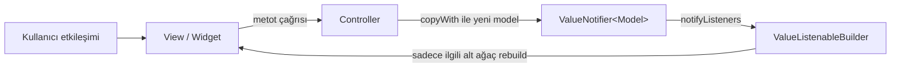
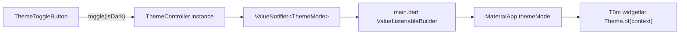

# State Akışı Referansı (ValueNotifier)

Bu doküman `SKILL.md` (flutter-feature-scaffold) ve `project.md` kurallarının **state yönetimi** tarafını detaylandırır.
Projede üretilen her ekran bu akışa UYMAK ZORUNDADIR.

---

## 1. Temel Prensip

- State **sadece controller** içinde, `ValueNotifier<T>` olarak tutulur.
- View **sadece dinler**: `ValueListenableBuilder<T>` ile.
- View **sadece tetikler**: controller metotlarını (`addWater`, `reset` vb.) çağırarak.
- Sayfa düzeyinde `setState` **KULLANILMAZ** (`project.md` §3.1).
- Harici state paketi (Provider, Bloc, Riverpod, GetX) **onay alınmadan EKLENMEZ** (`project.md` §3.3).

---

## 2. Tek Yönlü Veri Akışı



| Katman | Dosya | Sorumluluk | Yasak |
|---|---|---|---|
| Model | `models/<feature>_model.dart` | Immutable veri, `copyWith`, `fromJson`, `toJson` | Mutable alan, iş mantığı |
| Controller | `controllers/<feature>_controller.dart` | `ValueNotifier` tanımı, iş mantığı, `dispose` | `BuildContext`, widget import'u |
| View | `view/<feature>_view.dart` | Scaffold, controller ömrü, dinleme | `setState`, iş mantığı, sabit renk |
| Widget | `widgets/<feature>_card.dart` | Saf görsel parça, `const` constructor | Controller oluşturma |

---

## 3. Controller Yaşam Döngüsü

`ValueNotifier` bir `ChangeNotifier`'dır; **dispose edilmezse bellek sızıntısı oluşur.**
Bu yüzden ekran controller'ı şu kalıpla sahiplenir:

```dart
class WaterTrackerView extends StatefulWidget {
  const WaterTrackerView({super.key});

  @override
  State<WaterTrackerView> createState() => _WaterTrackerViewState();
}

/// setState ÇAĞRILMAZ. State sınıfı yalnızca controller ömrünü yönetir.
class _WaterTrackerViewState extends State<WaterTrackerView> {
  final WaterTrackerController _controller = WaterTrackerController();

  @override
  void dispose() {
    _controller.dispose();
    super.dispose();
  }

  @override
  Widget build(BuildContext context) {
    return ValueListenableBuilder<int>(
      valueListenable: _controller.currentWater,
      builder: (context, currentWater, _) => Text('$currentWater ml'),
    );
  }
}
```

> **Neden `StatelessWidget` değil?** `StatelessWidget` içinde `final _controller = Controller()` yazmak
> (a) `const` constructor'ı imkânsız kılar, (b) her rebuild'de yeni controller üretebilir, (c) `dispose` çağrılamaz.
> `StatefulWidget` burada **sadece yaşam döngüsü için** kullanılır; `project.md` §3.1'deki "ağır setState" yasağı ihlal edilmez.

---

## 4. Rebuild Kapsamını Daraltma

- `ValueListenableBuilder` ağacın **mümkün olan en alt** noktasına konur.
- Değişmeyen parçalar `child` parametresiyle bir kez oluşturulur:

```dart
ValueListenableBuilder<int>(
  valueListenable: controller.currentWater,
  child: const Icon(Icons.water_drop_rounded), // rebuild edilmez
  builder: (context, value, child) => Row(
    children: [child!, Text('$value ml')],
  ),
);
```

- Birden fazla bağımsız değer varsa her biri için ayrı `ValueNotifier` veya tek bir immutable model kullanılır.
  Tek model tercih edilirse güncelleme **daima** `copyWith` ile yapılır:

```dart
state.value = state.value.copyWith(value: state.value.value + 250);
```

---

## 5. Tema Akışı (Karanlık / Aydınlık Mod)

Tema da aynı kurala tabidir (`project.md` §6):



- `ThemeController` uygulama ömrü boyunca yaşayan tekil (singleton) bir nesnedir; bu yüzden `dispose` edilmez.
- Widgetlar renkleri **asla** sabit yazmaz; `Theme.of(context).colorScheme` ve `textTheme` kullanır.
  Böylece mod değişince tüm ekran otomatik olarak doğru paleti alır.

---

## 6. Yap / Yapma

| ✅ Yap | ❌ Yapma |
|---|---|
| `ValueNotifier<T>` + `ValueListenableBuilder<T>` | Sayfa düzeyinde `setState` |
| Controller'ı `State.dispose` içinde dispose et | Controller'ı `StatelessWidget` alanında oluştur |
| Modeli `copyWith` ile güncelle | Model alanını doğrudan değiştir |
| `Theme.of(context).colorScheme.primary` | `Colors.blue`, `Color(0xFF...)` |
| 40 satırı aşan build'i widget'a böl | Tek dev `build` metodu |
| Statik widgetlarda `const` | `const` eklenebilecek yerde unutmak |

---

## 7. Kontrol Listesi (her ekran için)

- [ ] State yalnızca controller içinde mi?
- [ ] Tüm `ValueNotifier`'lar `dispose` ediliyor mu?
- [ ] `setState` çağrısı yok mu?
- [ ] Hiçbir `build` metodu 40 satırı geçmiyor mu?
- [ ] Sabit renk/TextStyle yok, her şey temadan mı geliyor?
- [ ] Ekran aydınlık ve karanlık modda kontrol edildi mi?
- [ ] `flutter analyze` → 0 uyarı / 0 hata
- [ ] `flutter test` → tüm testler geçti
